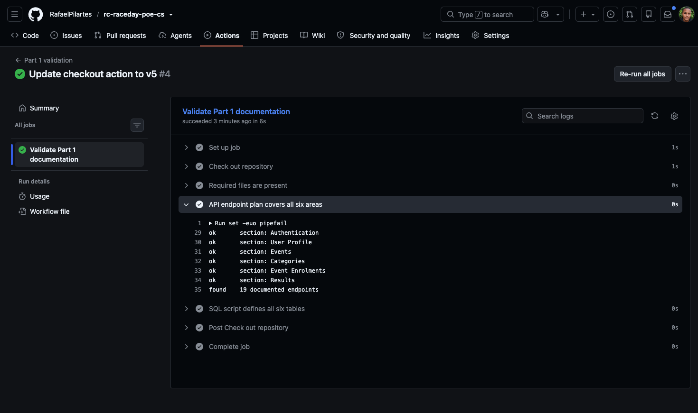
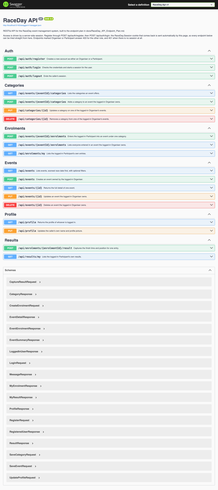

# RaceDay — Event Management System

RaceDay is a web-based event management platform built for the South African road running, walking, and cycling community. It replaces the paper registration sheets and disconnected spreadsheets that most local road events still rely on. Event Organisers use it to publish events, set up age or distance categories, and capture results. Participants use it to browse events, enter the category of their choice, and track their own race history over time.

This repository covers the three parts of the PROG6212 Portfolio of Evidence. Part 1 is the planning stage: an ERD, a full API endpoint plan, and a SQL script that builds and seeds the database. Part 2 is the RESTful API built against that plan, in `RaceDay.Api`, with its unit tests in `RaceDay.Api.Tests`. Part 3 will add the MVC front end on top of the same API.

## Roles

**Organiser** — creates, edits, and deletes events, defines the age or distance categories for each event, views who has enrolled, and captures finish times and positions once an event has taken place.

**Participant** — browses upcoming events, enrols in an event by picking a category, and can see their own enrolments and results at any time.

Both roles are stored in the same `Users` table and distinguished by a `RoleID` foreign key into a separate `Roles` table, rather than a free-text field. That decision is explained in more depth in the endpoint plan and the schema comments.

## Repository structure

```
/docs
  RaceDay_ERD.png              Entity relationship diagram, six entities, all keys and cardinalities marked
  RaceDay_API_Endpoint_Plan.md API endpoint plan, one row per endpoint across all six functional areas
  raceday_schema.sql           Full T-SQL schema plus seed data
  part2-swagger-ui.png         The running API in Swagger, all 19 endpoints
/RaceDay.Api                   Part 2: the ASP.NET Core 8 Web API
  Models/                      The six entities from the ERD
  Data/                        RaceDayDbContext and the Fluent API mapping
  Migrations/                  EF Core Code-First migrations
  Controllers/                 One controller per functional area
  Dtos/                        Request and response shapes
  Security/                    Session helpers and the SessionAuthorize filter
/RaceDay.Api.Tests             Part 2: xUnit tests
RaceDay.sln                    Solution tying the two projects together
```

## Part 1 — planning and database

### Running the SQL script

1. Open SQL Server Management Studio and connect to the target instance (an Azure SQL Database or a local SQL Server both work).
2. Open `raceday_schema.sql`.
3. Execute the whole script. It drops the six tables if they already exist, in dependency order, then recreates them and inserts the seed data.
4. Confirm the seed data with a quick check, for example `SELECT * FROM dbo.Events;` should return three rows.

The script has to run without errors on a clean instance before submission. Test it on your own Azure SQL Database before recording the video.

### Continuous integration

The `part1-validate.yml` workflow runs on every push and checks that Part 1 is complete: the `/docs` folder contains the ERD image, the endpoint plan, and the SQL script; the endpoint plan covers all six functional areas; and the SQL script defines all six tables with their seed data.



## Part 2 — the RESTful API

An ASP.NET Core 8 Web API built directly against the Part 1 endpoint plan. Entity Framework Core
runs Code-First against SQL Server, access is controlled by a server-side session rather than a
token, and every endpoint is testable from Swagger.

The API exposes the same 19 endpoints as `docs/RaceDay_API_Endpoint_Plan.md`, in the same six
groups:

| Area | Endpoints |
| --- | --- |
| Authentication | `POST /api/auth/register`, `POST /api/auth/login`, `POST /api/auth/logout` |
| User profile | `GET /api/profile`, `PUT /api/profile` |
| Events | `GET /api/events`, `GET /api/events/{id}`, `POST /api/events`, `PUT /api/events/{id}`, `DELETE /api/events/{id}` |
| Categories | `GET`/`POST /api/events/{eventId}/categories`, `PUT`/`DELETE /api/categories/{id}` |
| Event enrolments | `POST /api/events/{eventId}/enrolments`, `GET /api/enrolments/my`, `GET /api/events/{eventId}/enrolments` |
| Results | `POST /api/enrolments/{enrolmentId}/result`, `GET /api/results/my` |



### How authentication works

Registration takes a name, email, password and a role of either `Organiser` or `Participant`. The
password is hashed with BCrypt before it is stored; the `PasswordHash` column holds a 60 character
`$2a$` hash and the plain text is never written anywhere.

Login verifies the password against that hash and then writes the user id and role name into a
server-side session. The browser only ever receives the `RaceDay.Session` cookie — the id and the
role stay on the server. Everything after that reads the caller from the session, never from the
request body or the route, so a user cannot act as somebody else by editing an id.

Access is enforced by the `SessionAuthorize` filter in `RaceDay.Api/Security`:

- no session at all gives `401 Unauthorized`;
- a session with the wrong role gives `403 Forbidden`;
- `[SessionAuthorize]` on its own means any logged-in user, which is how Events and Categories stay
  readable by both roles.

Ownership is checked separately from the role. An Organiser who holds the right role but did not
create the event still gets `403` on it, which is what the "Owner" column in the Part 1 plan means.

### Requirements

- .NET 8 SDK
- A SQL Server instance. SQL Server Express, LocalDB, an Azure SQL Database or a SQL Server
  container all work; the API was developed against SQL Server 2022 in a container started with:

  ```bash
  docker run -d --name raceday-sql \
    -e "ACCEPT_EULA=Y" -e "MSSQL_SA_PASSWORD=RaceDay#Local2026" -e "MSSQL_PID=Developer" \
    -p 1433:1433 mcr.microsoft.com/mssql/server:2022-latest
  ```

  That password is the one in `appsettings.json`, so the two line up out of the box.
- The EF Core tools, if you want to run migrations from the command line:
  `dotnet tool install --global dotnet-ef --version 8.*`

### Setting up the database

The connection string lives under `ConnectionStrings:RaceDayDb` in `RaceDay.Api/appsettings.json`
and points at a local SQL Server on port 1433. It is a development login only. Point it at your own
instance either by editing that file or, better, by overriding it without touching the repository:

```bash
export ConnectionStrings__RaceDayDb="Server=localhost,1433;Database=RaceDay;User Id=sa;Password=<your password>;Encrypt=True;TrustServerCertificate=True"
```

For an Azure SQL Database with Entra ID instead:

```
Server=tcp:<your-server>.database.windows.net,1433;Database=RaceDay;Authentication=Active Directory Default;Encrypt=True
```

Then create the schema from the migrations:

```bash
dotnet ef database update --project RaceDay.Api
```

In Visual Studio the equivalent is `Update-Database` in the Package Manager Console with
`RaceDay.Api` selected as the default project.

That creates the same six tables as `docs/raceday_schema.sql` — `Roles`, `Users`, `Events`,
`Categories`, `Enrolments`, `Results` — with the same column types, check constraints and unique
indexes, and seeds the two rows of the `Roles` lookup. The sample users, events and enrolments from
the Part 1 script are not seeded by the migration: those rows carry placeholder password hashes, so
real accounts are created through `POST /api/auth/register` instead.

### Running the API

```bash
dotnet run --project RaceDay.Api
```

Swagger opens at `https://localhost:7067/swagger` (or `http://localhost:5142/swagger`). From there:

1. `POST /api/auth/register` an Organiser, and register a Participant as well.
2. `POST /api/auth/login` as the Organiser. Swagger keeps the session cookie from then on.
3. `POST /api/events` to publish an event, then `POST /api/events/{eventId}/categories` to add a
   category to it.
4. `POST /api/auth/logout`, log in as the Participant, and
   `POST /api/events/{eventId}/enrolments` to enter the event.
5. Try `POST /api/events` while still logged in as the Participant to see the `403`.
6. Log back in as the Organiser and capture a result with
   `POST /api/enrolments/{enrolmentId}/result`. Results are only accepted once the event date has
   passed, so use an event dated in the past for this step.

### Unit tests

```bash
dotnet test
```

84 tests across nine files, run against EF Core's in-memory provider with a fresh database per
test, so no SQL Server instance is needed to run them.

| File | What it covers |
| --- | --- |
| `RegistrationTests` | Account created under the chosen role, password stored only as a BCrypt hash, duplicate email refused, unknown role refused |
| `LoginTests` | Correct password opens a session carrying the user and role, wrong password and unknown email both answer 401 with identical wording, logout empties the session |
| `RoleAccessTests` | The filter's 401 and 403 answers, plus a reflection pass confirming every endpoint asks for the role the Part 1 plan gives it |
| `EventManagementTests` | Organiser creates, updates and deletes their own events; another Organiser is refused; an event with entries is not deleted |
| `CategoryTests` | Category CRUD, ownership, age range validation, both roles can list |
| `EnrolmentTests` | Participant enters an event and the row links participant, event and category; duplicates and cross-event categories refused; start list visible only to the owning Organiser |
| `ResultTests` | Results captured only by the owning Organiser and only after the event; one result per entry; Participants see only their own |
| `ProfileTests` | Both roles read and update their own profile; email and role cannot be changed through it |
| `DatabaseSeedTests` | The Roles seed reaches a freshly created database |

### Continuous integration

`.github/workflows/part2-ci.yml` restores, builds in Release and runs `dotnet test` on every push
and pull request.

> **Still to do before submitting:** push these commits, wait for the workflow to finish, and save
> the green build as `docs/part2-ci-green.png`, then replace this note with
> ``. The workflow has not run yet because the
> Part 2 commits are still local.

### Where the implementation goes beyond the Part 1 plan

Every route, HTTP method and role requirement matches the plan exactly. The implementation only
adds status codes for cases the plan did not spell out:

| Endpoint | Extra response | Why |
| --- | --- | --- |
| `DELETE /api/events/{id}` | `409 Conflict` | Participants are already entered; deleting would wipe their entries and any results |
| `DELETE /api/categories/{id}` | `409 Conflict` | Someone has already entered under that category |
| `POST /api/enrolments/{enrolmentId}/result` | `409 Conflict` | The ERD allows one result per enrolment, so the second capture is a conflict, not a bad request |
| `GET` / `POST /api/events/{eventId}/categories` | `404 Not Found` | The event in the route does not exist |
| `POST /api/events/{eventId}/enrolments` | `404 Not Found` | The event in the route does not exist |
| `PUT /api/categories/{id}` | `400 Bad Request` | `MinAge` is greater than `MaxAge` |
| `GET /api/events` | `400 Bad Request` | The `eventType` filter is not Run, Walk or Cycle |

## Video walkthrough

> **Still to do before submitting:** record both walkthroughs and replace the two lines below with
> their unlisted YouTube URLs. The submission requirements expect a working link for each part.

- **Part 1** — the reasoning behind the ERD, including why roles are normalised into their own
  table, the choices made in the endpoint plan, and a live run of `raceday_schema.sql` in SSMS.
  *Not yet recorded.*
- **Part 2** — the running API in Swagger, the code structure, how session authentication and
  role-based access work, and the unit tests passing. *Not yet recorded.*

## AI tools disclosure

Gimini was used during Part 1 to help review the ERD, and to write the GitHub Actions validation workflow in `.github/workflows/part1-validate.yml`. The SQL script was tested manually in SSMS against an Azure SQL Database.
